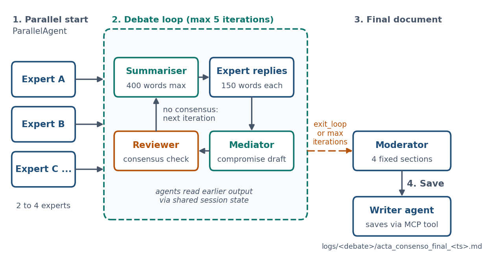

# Multi-Agent Expert Debate

Developed together with [Miquel Gómez Corral](https://github.com/MiquelGomezCorral).

<p align="center">
  
  
  
  
</p>

LLM "experts" with opposing roles debate a question until a reviewer agent judges that they have reached a concrete consensus. A moderator then writes the outcome as a structured Markdown document, and a writer agent saves it to disk through an MCP server. Built with [Google ADK](https://google.github.io/adk-docs/) on top of LiteLLM, so any OpenAI-compatible endpoint works.

**Key facts:** 12 built-in debates, 2 to 4 experts each, at most 5 debate iterations, output is a Markdown document with 4 fixed sections. Prompts and debates are in Spanish, so the documents are too.

<p align="center">
  
  <br>
  <em>One debate, end to end. The reviewer ends the loop early by calling <code>exit_loop</code>. "Consensus" is the judgement of a strict LLM reviewer, not a formal criterion, so it is only as reliable as the model behind it.</em>
</p>

## Quick start

```bash
python3.12 -m venv venv && source venv/bin/activate
pip install uv && uv pip install -r requirements.txt
cp .env.example .env      # model (LiteLLM name), api_base, api_key

cd app
export PYTHONPATH=.              # the scripts import config.py from app/
python agent/run_agent.py -h        # list debates and their indices
python agent/run_agent.py -d 0      # run one debate by index
python agent/run_agent.py           # run all debates
adk run agent/                      # type any question for the default experts
```

The final document is saved under `logs/<debate name>/` at the repository root.

`requirements-original.txt` keeps the exact pins used before the cleanup.

## How a debate runs

1. **Initial positions (parallel):** every expert states its view on the question at the same time.
2. **Debate loop (up to 5 iterations, `ciclo_debate_max_iterations`):** a summariser condenses the previous round, each expert replies and says what it is willing to concede, a mediator drafts a compromise and says whether consensus is sufficient, and a reviewer applies a strict check. If it finds a specific, concrete agreement it calls `exit_loop`; otherwise the next iteration starts.
3. **Final document:** a moderator writes the result with four fixed sections (topic, process summary, agreed decision, justified recommendation), written even when no consensus was reached. The writer agent saves it through the MCP tool `escribir_archivo` ("write file"), which appends a timestamp to the file name.

## Defining experts

Experts are plain dictionaries in `app/config.py` (`DEBATES`). A debate is a question plus a list of agents, and each agent is passed straight to an ADK `LlmAgent`. This is one of the experts of the first debate (the instruction is shortened here):

```python
{
    "name": "experto_etica",
    "description": "Experto en ética y riesgos socio-económicos.",
    "instruction": (
        "Eres un experto en ética y humanidades. Tu objetivo es señalar "
        "los riesgos, sesgos y posibles consecuencias negativas ..."
    ),
    "output_key": "postura_etica",
}
```

To add a debate, append an entry with `exp_name`, `question` and `agents`.

## The 12 debates

<details>
<summary>Show all 12 (questions translated from Spanish; <code>exp_name</code> is the folder name in <code>logs/</code>)</summary>

Questions are translated from Spanish; the debate name (`exp_name`) is what appears in `logs/`.

**Policy and business questions about AI**

- `IA_innovacion_vs_etica`: How can we balance AI innovation with ethical considerations?
- `IA_politicas_publicas`: Is it viable to delegate part of public-policy decision making to an AI system?
- `IA_educacion_primaria`: Should generative AI be introduced in primary education as a personalised tutor?
- `IA_toma_decisiones_empresa`: Should a company move its whole architecture to generative AI for operational decisions?
- `IA_atencion_cliente`: Is it viable to replace 80% of human customer-service agents with generative AI?
- `IA_prediccion_emergencias`: Should an AI emergency-prediction system be deployed even if it produces false positives?

**Ethical dilemmas**

- `dilema_coche_autonomo_edad`: A self-driving car must hit either a 16-year-old or an 80-year-old. What should it decide?
- `dilema_tren_servidores`: A train will kill 5 people. Pulling the lever saves them but destroys all your AI servers. Do you pull it?
- `dilema_avion_paracaidas`: A plane is about to crash and there is one parachute too few. Who sacrifices themselves?
- `dilema_paracaidas_sobrante`: 99 people on a plane, 100 parachutes. What do we do?
- `dilema_videojuego_piedad`: You have won 13 games in a row against a friend. Should you let them win the next one?
- `minecraft_venganza_perro`: Your only available friend killed your dog in Minecraft. Take revenge or forgive?

</details>

## Repository layout

```
app/
  config.py            configuration and the DEBATES definitions
  agent/
    debate.py          builds the agent system (parallel, loop, sequential)
    run_agent.py       CLI to run one or all debates
    agent.py           entry point for `adk run` (free-form question)
  mcp/
    write.py           MCP server that writes the final document
```
